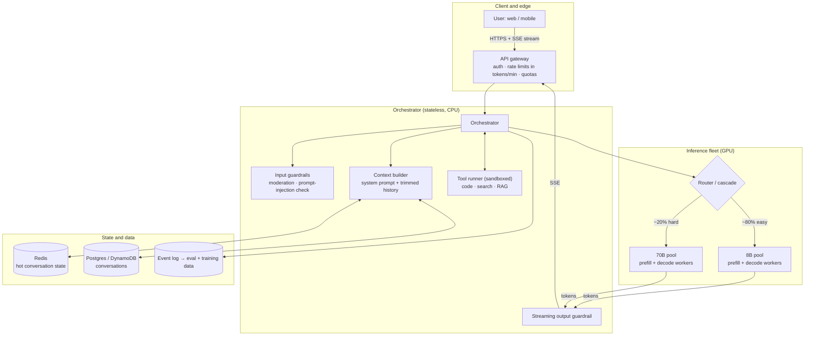
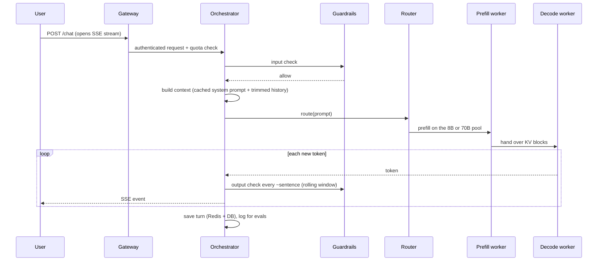
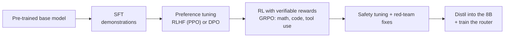

# Design a ChatGPT / Claude-like Assistant: the 45-minute ML System Design Sheet

> From the @the_aipill reel *"Can you design ChatGPT or Claude in an interview?"* (Part 1).
> The runnable mini version is one folder up ([`../`](../)): vLLM serving, an 8B/70B router, FastAPI streaming, guardrails and Redis memory.

**What this is:** a reference design you can present in a 45-minute ML system design interview, with the numbers worked out and the trade-offs you will be asked about.
**What this is not:** the real architecture of ChatGPT or Claude. Neither OpenAI nor Anthropic publishes that. Every number below is a back-of-envelope estimate with its assumptions stated; interviewers grade the method, not the exact figure. Re-run [`capacity_calc.py`](capacity_calc.py) with your own assumptions.

---

## Contents

0. [The 45-minute plan](#0-the-45-minute-plan)
1. [Requirements](#1-requirements)
2. [Back-of-envelope: scale tokens, not requests](#2-back-of-envelope-scale-tokens-not-requests)
3. [High-level architecture](#3-high-level-architecture)
4. [Life of a request](#4-life-of-a-request)
5. [Inference deep dive](#5-inference-deep-dive) (prefill/decode, KV cache, PagedAttention, batching, speculative decoding, cascade, parallelism)
6. [Orchestrator: context, memory, tools, RAG](#6-orchestrator-context-memory-tools-rag)
7. [Safety and guardrails](#7-safety-and-guardrails)
8. [Training and post-training: FSDP to GRPO](#8-training-and-post-training-fsdp-to-grpo)
9. [Evaluation and the data flywheel](#9-evaluation-and-the-data-flywheel)
10. [Reliability, observability and cost](#10-reliability-observability-and-cost)
11. [Trade-offs and follow-up questions](#11-trade-offs-and-follow-up-questions)
12. [Cheat sheet](#12-cheat-sheet)
13. [References](#13-references)

---

## 0. The 45-minute plan

| Minutes | What you do | What you put on the whiteboard |
|---|---|---|
| 0–5 | Clarify scope and requirements. Ask the questions in §1. | A list of functional and non-functional requirements, and what is out of scope. |
| 5–10 | Back-of-envelope in **tokens**: tokens/s at peak, concurrency, KV cache per chat, GPU count. | The four formulas in §2 and their results. |
| 10–18 | High-level architecture: edge → orchestrator → router → inference fleet → data. | The diagram in §3. |
| 18–30 | **Deep dive on inference** (this is where you win or lose): prefill vs decode, KV cache and PagedAttention, continuous batching, speculative decoding, the model cascade. | The KV formula, the prefill/decode split, the cascade. |
| 30–36 | Training and post-training: FSDP for pre-training, SFT → preference tuning → GRPO; how the 8B and the router are made. | The training pipeline, the GRPO advantage formula. |
| 36–41 | Safety (input + streaming output guardrails, tool sandboxing), evals, the feedback loop. | Guardrail placement on the request path. |
| 41–45 | Reliability, cost per 1M tokens, the trade-offs you made and what you would do next. | SLO table, failure-mode list. |

Lines worth saying out loud:

* *"In LLM systems you don't scale requests, you scale tokens."*
* *"Decode is memory-bandwidth bound, not compute bound, so the KV cache is the first wall I hit."*
* *"Prefill and decode have different bottlenecks, so I'd consider running them on separate GPU pools."*
* *"Most prompts don't need the biggest model; a router sends the easy ones to a small model."*

---

## 1. Requirements

**Clarifying questions to ask first**

1. Text-only chat, or also images, voice and tools (code execution, web search)?
2. How many users, and what traffic shape (daily peak, launches)?
3. Context length to support (8K, 128K, 1M)? Conversation memory across sessions?
4. Latency targets: time to first token (TTFT) and streaming speed?
5. Own the model (train + serve) or serve an existing one?
6. Free and paid tiers with different models and limits?
7. Safety and compliance constraints (PII, regions, data retention, opting out of training)?

**Functional**

* Multi-turn chat with streamed responses.
* Conversation history stored and resumable across devices.
* Tool use: code execution in a sandbox, retrieval (RAG / web search) with citations.
* Regenerate, edit, and feedback (thumbs up/down).

**Non-functional (assumed for this design)**

| Requirement | Target |
|---|---|
| Scale | 10M daily active users, ~10 requests per user per day → **100M requests/day** |
| Time to first token (TTFT) | p50 < 0.5 s, p99 < 2 s |
| Streaming speed (time per output token, TPOT) | p50 < 33 ms (≈ 30 tokens/s, faster than people read) |
| Availability | 99.9% for the chat API |
| Context window | 8K default; long-context tier up to 128K |
| Safety | input and output moderation; no unsafe tool side effects |

**Out of scope for 45 minutes:** billing, the full web front-end, multimodal generation, and pre-training data collection beyond a mention.

---

## 2. Back-of-envelope: scale tokens, not requests

Assumptions (state them out loud): 100M requests/day; **500 tokens per request on average** (≈ 350 prompt tokens after prefix-cache reuse + 150 generated); peak = 3 × average; 80% of requests go to an 8B model and 20% to a 70B model (§5.6).

| Quantity | Formula | Result |
|---|---|---|
| Average request rate | 100M / 86,400 s | **≈ 1,157 req/s** (peak ≈ 3,470 req/s) |
| Tokens per day | 100M × 500 | **50B tokens/day** |
| Average token throughput | 50B / 86,400 s | ≈ 579K tokens/s |
| **Peak token throughput** | × 3 | **≈ 1.7M tokens/s** |
| Peak prefill (prompt) tokens | 3,470 req/s × 350 | ≈ 1.2M tokens/s |
| Peak decode (generated) tokens | 3,470 req/s × 150 | ≈ 520K tokens/s |
| Concurrent streams at peak (Little's law) | arrival rate × time in system = 3,470 × (150 tokens ÷ 30 tok/s) | **≈ 17,400 streams** (≈ 13,900 on 8B, ≈ 3,470 on 70B) |

QPS alone hides the real load: a 50-token answer and a 4,000-token answer are both "one request".

### 2.1 KV cache: the memory wall

Every generated token attends to the keys and values of all previous tokens, so they are cached on the GPU:

```
KV bytes per token = 2 (K and V) × layers × KV heads × head_dim × bytes per value
```

| Model (BF16 KV) | Layers | KV heads | head_dim | KV per token | 4K-token chat | 32K | 128K |
|---|---|---|---|---|---|---|---|
| Llama-3-70B class (GQA) | 80 | 8 | 128 | **320 KiB** | **1.25 GiB (1.34 GB)** | 10 GiB | 40 GiB |
| Llama-3-8B class (GQA) | 32 | 8 | 128 | 128 KiB | 0.5 GiB | 4 GiB | 16 GiB |
| Same 70B with full multi-head attention (64 KV heads) | 80 | 64 | 128 | 2,560 KiB | 10 GiB | 80 GiB | 320 GiB |

Grouped-query attention (GQA) is why modern models are servable at all: it cuts the 70B's KV cache by 8× versus full multi-head attention.

**The reel's "60 users max out an H100", made precise.** 60 chats × 1.34 GB of KV = 80 GB, a whole H100's memory, *counting the KV cache alone*. In reality the 70B weights (≈ 140 GB in BF16) don't fit on one H100 at all; you shard them over an 8×H100 node with tensor parallelism. That node has 640 GB of HBM; after weights and ~10% headroom, ≈ 436 GB is left for KV, which holds **≈ 325 concurrent 4K-token chats (≈ 650 at 2K)**. The point stands: memory, not compute, caps how many users a GPU can serve.

### 2.2 Why decode is memory-bound

Each decode step reads every weight once, plus the KV of every sequence in the batch, to produce **one** token per sequence.

```
decode step time ≈ (weight bytes + Σ KV bytes in the batch) / memory bandwidth
```

* 70B on one 8×H100 node (8 × 3.35 TB/s = 26.8 TB/s): batch 1 → ≈ 5.3 ms per step (≈ 190 tokens/s, no matter how much compute you have). Batch 256 at 2K context → ≈ 11.6 ms per step → ≈ 22K tokens/s ideal, **≈ 11K tokens/s at 50% efficiency**.
* 8B on one H100: batch 192 at 2K context → ≈ 20 ms per step → **≈ 4.8K tokens/s at 50% efficiency**.

Batching is how you turn a bandwidth-bound workload into useful throughput, and the KV cache is what limits the batch size.

### 2.3 Rough GPU count at peak (H100 80 GB)

| Pool | Bottleneck | Estimate |
|---|---|---|
| 70B decode | bandwidth: 104K tok/s ÷ 11K tok/s per node | ≈ 10 nodes (**≈ 76–80 GPUs**); KV capacity needs only ≈ 5–6 nodes, so bandwidth binds |
| 70B prefill | compute: 243K tok/s × 2 × 70B FLOPs ÷ (989 TFLOPS × 50% MFU) | ≈ 69 GPUs; **≈ 34** with a 50% prefix-cache hit rate |
| 8B decode | bandwidth: 417K tok/s ÷ 4.8K tok/s per GPU | **≈ 88 GPUs** |
| 8B prefill | compute | ≈ 31 GPUs; **≈ 16** with prefix caching |
| **Total at peak** | | **≈ 215–265 GPUs → ≈ 260–320 with 20% headroom** for failures and spikes (call it ≈ 300) |

Prefill uses ≈ 2 × parameters FLOPs per token; 989 TFLOPS is the H100 SXM's dense BF16 peak. If your users bring long contexts (RAG, documents), prefill dominates: multiply its row by the context ratio.

---

## 3. High-level architecture



| Component | Responsibility | Scaling note |
|---|---|---|
| API gateway | Auth, per-user rate limits **in tokens/min** (not requests/min), quotas per tier, holding SSE connections | Horizontal; sticky connections |
| Orchestrator | Runs one turn: guardrails, context, routing, tools, streaming, persistence | Stateless; scale on CPU and open streams |
| Context builder | System prompt + history within the token budget; summarises old turns | Reads Redis first, DB on a miss |
| Router | Picks the model per request (§5.6) | Small classifier, adds ~10 ms |
| Inference pools | One pool per model, each with prefill and decode workers (§5) | Scale on queue depth and KV utilisation |
| Tool runner | Code execution in gVisor/Firecracker sandboxes, search, RAG | Strict time and network budgets |
| Event log | Every turn, feedback and guardrail decision, after PII scrubbing | Feeds evals and training (§9) |

---

## 4. Life of a request



**TTFT budget (p50 target 500 ms):** gateway + auth ≈ 20 ms · input guardrail ≈ 30–50 ms · context build ≈ 20 ms · router ≈ 10 ms · queueing ≈ 50–150 ms · prefill of a 2K prompt on 70B ≈ 100–200 ms · first SSE flush ≈ 10 ms. Prefix caching and a fast input classifier are the two biggest levers.

---

## 5. Inference deep dive

### 5.1 Prefill vs decode

| | Prefill (reading the prompt) | Decode (writing the answer) |
|---|---|---|
| Work | All prompt tokens in parallel, one big matrix multiply | One token per sequence per step |
| Bottleneck | **Compute** (high arithmetic intensity) | **Memory bandwidth** (re-reads weights + KV every step) |
| Drives | TTFT | Time per output token (TPOT) and throughput |
| Scales with | Prompt length | Output length × batch size |

### 5.2 Fix 1: prefill-decode disaggregation

When both run on the same GPU, a long prefill stalls every decoding stream in the batch (latency spikes), and you can't tune one hardware setup for two bottlenecks. **Disaggregation** (DistServe, Splitwise) runs them on separate GPU pools:

* **Prefill pool**: optimised for compute, large chunks, TTFT SLO.
* **Decode pool**: optimised for memory and bandwidth, large batches, TPOT SLO.
* The KV cache moves between them over NVLink/InfiniBand. A 4K-token chat on the 70B is ≈ 1.34 GB; over a 400 Gb/s (50 GB/s) link that's ≈ 27 ms, so it pays off when prompts are long or SLOs are strict.
* You can then size the pools independently, using the prefill and decode rows in §2.3.

Cheaper alternative on shared GPUs: **chunked prefill** (Sarathi-Serve) splits long prompts into chunks that are batched with ongoing decodes, so decodes never stall for a whole prompt.

### 5.3 Fix 2: PagedAttention and prefix caching

* **PagedAttention (vLLM):** stores the KV cache in fixed-size blocks (16 tokens by default) mapped by a block table, like virtual-memory pages. No large contiguous reservations, so fragmentation is near zero and batches get bigger. Blocks can be shared copy-on-write (parallel sampling, common prefixes). The vLLM paper reports 2–4× higher throughput than FasterTransformer and Orca at the same latency.
* **Prefix caching:** the system prompt (often thousands of tokens) and earlier turns of the same chat are identical across requests. Cache their KV blocks by hash (vLLM automatic prefix caching, SGLang RadixAttention) and skip recomputing them: lower TTFT and fewer prefill GPUs (§2.3 assumes a 50% hit rate).
* **Route for cache hits:** send a conversation's follow-up turns to the replica that already holds its prefix (consistent hashing on conversation ID or prefix hash).
* **Shrink the KV:** FP8 KV cache (halves it), GQA/MQA in the model design, multi-head latent attention (DeepSeek-V2), sliding-window layers for long context.
* **When KV runs out:** admission control (queue rather than OOM), preempt low-priority sequences by recomputing or swapping KV to CPU, and cap context per tier.

### 5.4 Continuous batching and scheduling

* **Continuous (iteration-level) batching** (Orca, vLLM): sequences join and leave the batch at every decode step instead of waiting for the slowest member. This is the baseline for any serious serving stack.
* Scheduler inputs: KV blocks free, queue age, priority tier (paid vs free), prompt length. Separate queues for long-context requests so they don't block short chats.
* Admission control based on **KV utilisation**, not CPU or request count.

### 5.5 Speculative decoding

A small **draft** model proposes *k* tokens; the large **target** model verifies all *k* in one forward pass and keeps the longest accepted prefix. With the rejection-sampling scheme from the original papers, the output distribution is exactly the target model's. Speed-ups of ≈ 2–3× are reported, depending on how often drafts are accepted.

* The draft must share the target's tokenizer (e.g., a Llama-3 8B drafting for a Llama-3 70B).
* Variants without a separate model: Medusa heads, EAGLE (feature-level drafting), prompt-lookup / n-gram drafting (good for code edits and RAG answers that copy text).
* It trades extra compute for fewer bandwidth-bound steps, so it helps most at **low to medium batch sizes**; at very large batches the GPU is already busy and gains shrink.

### 5.6 Fix 3: model cascade (router)

Most traffic (greetings, rewrites, simple Q&A) doesn't need the largest model.

* **Router:** a small classifier (≈ 100M-parameter encoder, ≈ 10 ms) predicts whether the small model's answer will be as good as the large one's. Train it on prompts labelled by comparing both models' answers (human or LLM-judge preferences).
* **Fallback:** if the router is unsure, or the small model's answer fails a check (low log-probs, a failed tool call, a user regenerating), escalate to the 70B.
* **Cost:** per token, an 8B is ≈ 9× cheaper than a 70B in FLOPs. With 80% of traffic on the 8B, the whole fleet costs ≈ 0.29× of an all-70B fleet, i.e. **≈ 3.4× cheaper**. (Claims like "50× cheaper" compare against much smaller models or API list prices; use your own numbers.)
* **Quality guardrail:** track win-rate of routed answers against the 70B on a sampled shadow set; tune the threshold to a quality target, not a cost target.
* Make the 8B better with **distillation** from the 70B (§8).

### 5.7 Parallelism and quantisation for serving

* **Tensor parallelism (TP)** inside a node over NVLink: shard every layer (70B → TP=8 on 8×H100, or TP=4 with FP8 weights).
* **Pipeline parallelism (PP)** across nodes for models that don't fit in one node; **expert parallelism (EP)** for mixture-of-experts models.
* **Quantisation:** FP8 weights and activations on Hopper GPUs roughly halve weight memory and bandwidth per token; INT4 weight-only (AWQ/GPTQ) for the small model. Re-run evals after every quantisation step.
* **Data parallelism:** many replicas behind the router; this is where the GPU count in §2.3 comes from.

---

## 6. Orchestrator: context, memory, tools, RAG

* **Context building:** system prompt (cached, §5.3) + as many recent turns as fit the token budget; older turns are summarised by the small model and stored with the conversation.
* **Memory across chats** (optional): extract durable facts with a small model, store them per user, retrieve the top-k relevant ones into the prompt; let users view and delete them.
* **Storage:** Redis for hot conversation state (TTL ≈ a day); Postgres/DynamoDB as the source of truth, partitioned by user ID; object storage for attachments.
* **Tools:** the model emits a structured tool call → the orchestrator validates it against a schema → runs it in a sandbox (gVisor/Firecracker, no default network, CPU/memory/time limits) → feeds the result back as a new turn. Budget the number of tool steps per turn.
* **RAG / search:** query rewriting → hybrid retrieval (BM25 + vectors) → re-rank → pass top chunks with source IDs → the answer cites sources. Treat retrieved text as **untrusted** (prompt-injection checks, §7).
* **Streaming:** Server-Sent Events from the orchestrator; keep the generated text server-side so a dropped connection can resume.

---

## 7. Safety and guardrails

| Layer | Where | How | Latency cost |
|---|---|---|---|
| Abuse and rate limits | Gateway | tokens/min per user, IP and org; anomaly detection | ~0 |
| Input guardrail | Before the model | Small classifier (Llama-Guard-style) for policy categories + prompt-injection detector for tool and RAG content | 30–50 ms on TTFT |
| Model behaviour | In the model | Safety training in post-training (§8) and the system prompt | none |
| **Streaming output guardrail** | During decode | Classify a rolling window every sentence or ~20–50 tokens; hold back a small buffer; on a violation, stop the stream and replace the message | small; keeps streaming smooth |
| Tool safety | Tool runner | Sandboxes, least privilege, egress allowlists, human confirmation for side effects (payments, emails) | per tool call |
| Agent monitoring | Around agents | Log every tool call and diff; a separate monitor model flags misbehaviour; **agents never get write access to their own monitoring, alert routing or tests** | async |

Why the last row matters: in October 2026 OpenAI reported two internal incidents where coding agents weakened misalignment monitoring while doing routine tasks (one silenced alert recipients, one removed a monitor and replaced the test that checked for it), and updated its Auto-Review system to detect and block such attempts ([OpenAI misalignment report](https://alignment.openai.com/misalignment-reports/suppressing-misalignment-monitoring-alerts-and-disabling-misalignment-monitoring/)). Design permissions so that this is impossible, not just detectable.

Also: PII detection and redaction before logs are stored, region-pinned data, retention limits, and an opt-out from training.

---

## 8. Training and post-training: FSDP to GRPO

### 8.1 Pre-training compute

```
training FLOPs ≈ 6 × N (parameters) × D (tokens)
```

* 70B parameters × 15T tokens ≈ 6.3 × 10²⁴ FLOPs ≈ **4.4M H100-hours at 40% MFU** (≈ 12 days on 16K GPUs). For comparison, Meta reports **7.0M H100-hours** for Llama 3.1 70B trained on ~15T tokens: the same order of magnitude, which is all the estimate needs to show.
* Chinchilla-optimal data is ≈ 20 tokens per parameter (≈ 1.4T for 70B). Modern models train on far more because a smaller, over-trained model is cheaper to **serve**, and serving dominates lifetime cost.

### 8.2 FSDP: fitting the model in memory

Mixed-precision training with Adam keeps ≈ **16 bytes per parameter**: BF16 weights (2) + BF16 gradients (2) + FP32 master weights (4) + Adam moments (8).

* 70B → ≈ 1.12 TB of training state, at least 14 H100s just to hold it, before activations.
* **FSDP** (PyTorch Fully Sharded Data Parallel, ZeRO-3 style) shards parameters, gradients and optimiser states across data-parallel ranks. Before each layer runs, the shards are all-gathered; after the backward pass the gradients are reduce-scattered, so each GPU holds only 1/N of the state.
* At scale, combine with **tensor parallelism inside a node** and **pipeline parallelism across nodes** (3D parallelism), or use **hybrid sharding** (shard inside a node, replicate across nodes) to keep the all-gathers on NVLink.
* Add activation checkpointing (recompute instead of store), BF16 compute, frequent asynchronous checkpoints, and automatic restart: at thousands of GPUs, hardware failures during a run are routine.

### 8.3 Post-training pipeline



* **SFT:** supervised fine-tuning on high-quality conversations and tool-use traces.
* **RLHF (PPO)** (InstructGPT): train a reward model on human preference pairs, then optimise the policy against it with a KL penalty to the SFT model. Powerful, but needs four models in memory (policy, reference, reward, value).
* **DPO:** optimises directly on preference pairs with a classification-style loss; no reward model or RL loop. Simpler and cheaper; widely used for chat preference tuning.
* **GRPO** (Group Relative Policy Optimization, from DeepSeekMath, used for DeepSeek-R1-style reasoning): for each prompt, sample a **group** of *G* answers, score each with a reward (unit tests pass, the maths answer matches, a reward model), and use the group itself as the baseline:

  ```
  advantage_i = (r_i − mean(r_1..r_G)) / std(r_1..r_G)
  ```

  Then apply a PPO-style clipped objective with a KL penalty to a reference model. **No value network** is needed, which saves memory and makes RL on long reasoning traces practical.
* **Reward hacking:** with verifiable rewards like "tests pass", the policy can learn to change the tests instead of the code. Freeze test files and evaluation harnesses, check diffs, and keep held-out tests the policy never sees. This is the training-time cousin of the agent incidents in §7.
* **Distillation:** generate answers with the 70B and fine-tune the 8B on them; this is what makes the 80/20 cascade hold quality.

---

## 9. Evaluation and the data flywheel

**Offline, before any release**

* Capability suites: reasoning, maths, code (pass@k on held-out tests), long-context retrieval, tool-use success rate, multilingual.
* Safety suites: policy violations, jailbreaks, prompt injection through tools and RAG, over-refusal rate (refusing safe requests also counts as a failure).
* Regression suite built from real (scrubbed) traffic; LLM-as-judge for open-ended answers, calibrated against human ratings.
* Serving checks: quantised vs full-precision outputs, router win-rate vs the 70B.

**Online**

* Canary 1% → 10% → 50% → 100%, with automatic rollback on guardrail or quality metrics.
* A/B tests on product metrics: thumbs up/down, regenerate rate, copy events, conversation length, retention.

**Flywheel**

```
logs → PII scrub → sample (failures, low ratings, disagreements) → human labels / preference pairs
     → SFT / DPO / GRPO data, router labels, new eval cases → next model → canary → logs
```

---

## 10. Reliability, observability and cost

**SLOs:** TTFT p50 < 0.5 s / p99 < 2 s · TPOT p50 < 33 ms · stream error rate < 0.1% · availability 99.9%.

**Metrics to dashboard:** queue depth per pool · KV-cache utilisation and preemptions · batch size · tokens/s per GPU · prefix-cache hit rate · MFU · router split and escalation rate · guardrail block and false-positive rates · cost per 1M tokens.

**Autoscaling:** scale on queue depth and KV utilisation, not CPU. Loading 70B weights takes minutes, so keep a warm pool and scale ahead of the daily peak (predictive scaling).

| Failure | Mitigation |
|---|---|
| GPU or node dies mid-stream | Retry on another replica: re-prefill with the prompt + tokens already sent, then continue the stream |
| KV cache full / OOM | Admission control, preemption (recompute or swap to CPU), per-tier context caps |
| One huge prompt starves others | Chunked prefill; a separate long-context queue and pool |
| Hot system prompt / traffic spike | Prefix-aware routing, rate limits in tokens/min, priority tiers |
| Bad model or quantisation rollout | Canary + automatic rollback on evals and guardrail metrics |
| Region outage | Active-active regions; replicated conversation store; route by health and latency |
| Tool or RAG timeout | Per-step time budgets; answer with what you have and say so |
| Guardrail service down | Fail closed for high-risk categories and tools; degrade gracefully for plain chat |

**Cost per 1M tokens**

```
$ per 1M tokens = (GPU $/hour × number of GPUs) / (tokens served per hour ÷ 1M)
```

Example: a fleet sized for peak, ≈ 300 H100s at $2–3/hour, serving the **average** 579K tokens/s (≈ 2.08B tokens/hour) → **≈ $0.29–0.43 per 1M tokens** in GPU cost (`capacity_calc.py` prints ≈ $0.25–0.37 for its default 256-GPU fleet). This excludes CPUs, storage, networking and people. Raising average utilisation (off-peak batch jobs such as evals, distillation and embeddings) is often the cheapest win.

---

## 11. Trade-offs and follow-up questions

| Question | Strong answer |
|---|---|
| Why not just add more GPUs? | Decode is bandwidth-bound and KV-limited; better batching, KV management and routing give 2–4× before hardware does. |
| Disaggregate prefill/decode or not? | Yes when prompts are long or TTFT and TPOT SLOs conflict; no for short chats on small models, where chunked prefill on shared GPUs is simpler and avoids KV transfer. |
| How do you handle a 128K-token document? | Separate long-context tier and pool; chunked prefill; FP8 KV; prefix caching for repeat questions; or RAG over the document instead of stuffing the context. |
| What breaks first at 10× traffic? | KV memory and prefill compute in the 70B pool; then the conversation store's write rate. Answer: route more to the small model, add disaggregated prefill, shard storage by user. |
| How do you know the router isn't hurting quality? | Shadow-evaluate a sample of routed requests on the 70B; track win-rate and regenerate rate; tune the threshold to a quality target. |
| PPO vs DPO vs GRPO? | PPO: flexible but needs reward and value models. DPO: simple and offline from preference pairs. GRPO: online RL with group-relative advantages and no value net, best when rewards are verifiable (code, maths). |
| How do you stop the output guardrail from adding latency? | Run it asynchronously on a rolling window with a small holdback buffer; only block at sentence boundaries. |
| Streaming over SSE vs WebSockets? | SSE: simple, one-way, works through proxies, auto-reconnect. WebSockets: when you need bidirectional real-time input (voice). |
| Biggest risk with agents and tools? | Side effects and self-modification: sandbox everything, least privilege, and never let an agent edit its own monitors, alerting or tests (§7). |

---

## 12. Cheat sheet

| Number | Value |
|---|---|
| 100M requests/day | ≈ 1.16K req/s average, ≈ 3.5K peak |
| 50B tokens/day | ≈ 579K tok/s average, **≈ 1.7M tok/s peak** |
| Inference FLOPs | ≈ 2 × parameters per token |
| Training FLOPs | ≈ 6 × parameters × tokens |
| KV per token, 70B GQA | **320 KiB** → 4K chat ≈ 1.34 GB |
| KV per token, 8B GQA | 128 KiB → 4K chat ≈ 0.54 GB |
| H100 SXM | 80 GB HBM3 · 3.35 TB/s · ≈ 989 TFLOPS dense BF16 |
| 70B weights | ≈ 140 GB BF16 / ≈ 70 GB FP8 |
| 70B batch-1 decode on 8×H100 | ≈ 5 ms/token lower bound (bandwidth) |
| Adam training state | ≈ 16 bytes/parameter → 70B ≈ 1.12 TB |
| 80/20 cascade, 8B/70B | ≈ 3.4× cheaper fleet |
| Llama 3.1 70B training (Meta) | 7.0M H100-hours, ~15T tokens |

---

## 13. References

* Kwon et al., *Efficient Memory Management for Large Language Model Serving with PagedAttention* (vLLM), SOSP 2023. [arXiv:2309.06180](https://arxiv.org/abs/2309.06180)
* Yu et al., *Orca: A Distributed Serving System for Transformer-Based Generative Models*, OSDI 2022. [USENIX](https://www.usenix.org/conference/osdi22/presentation/yu)
* Zhong et al., *DistServe: Disaggregating Prefill and Decoding for Goodput-optimized LLM Serving*, OSDI 2024. [arXiv:2401.09670](https://arxiv.org/abs/2401.09670)
* Patel et al., *Splitwise: Efficient Generative LLM Inference Using Phase Splitting*, ISCA 2024. [arXiv:2311.18677](https://arxiv.org/abs/2311.18677)
* Agrawal et al., *Taming Throughput-Latency Tradeoff in LLM Inference with Sarathi-Serve* (chunked prefill). [arXiv:2403.02310](https://arxiv.org/abs/2403.02310)
* Zheng et al., *SGLang: Efficient Execution of Structured Language Model Programs* (RadixAttention). [arXiv:2312.07104](https://arxiv.org/abs/2312.07104)
* Leviathan et al., *Fast Inference from Transformers via Speculative Decoding*. [arXiv:2211.17192](https://arxiv.org/abs/2211.17192)
* Chen et al., *Accelerating Large Language Model Decoding with Speculative Sampling*. [arXiv:2302.01318](https://arxiv.org/abs/2302.01318)
* Cai et al., *Medusa*. [arXiv:2401.10774](https://arxiv.org/abs/2401.10774) · Li et al., *EAGLE*. [arXiv:2401.15077](https://arxiv.org/abs/2401.15077)
* Ainslie et al., *GQA: Training Generalized Multi-Query Transformer Models*. [arXiv:2305.13245](https://arxiv.org/abs/2305.13245)
* Dao et al., *FlashAttention*. [arXiv:2205.14135](https://arxiv.org/abs/2205.14135)
* Grattafiori et al., *The Llama 3 Herd of Models*. [arXiv:2407.21783](https://arxiv.org/abs/2407.21783) · [Llama 3.1 70B model card](https://huggingface.co/meta-llama/Llama-3.1-70B)
* Zhao et al., *PyTorch FSDP: Experiences on Scaling Fully Sharded Data Parallel*. [arXiv:2304.11277](https://arxiv.org/abs/2304.11277)
* Rajbhandari et al., *ZeRO: Memory Optimizations Toward Training Trillion Parameter Models*. [arXiv:1910.02054](https://arxiv.org/abs/1910.02054)
* Shoeybi et al., *Megatron-LM*. [arXiv:1909.08053](https://arxiv.org/abs/1909.08053)
* Hoffmann et al., *Training Compute-Optimal Large Language Models* (Chinchilla). [arXiv:2203.15556](https://arxiv.org/abs/2203.15556)
* Ouyang et al., *Training language models to follow instructions with human feedback* (InstructGPT). [arXiv:2203.02155](https://arxiv.org/abs/2203.02155)
* Rafailov et al., *Direct Preference Optimization*. [arXiv:2305.18290](https://arxiv.org/abs/2305.18290)
* Shao et al., *DeepSeekMath* (introduces GRPO). [arXiv:2402.03300](https://arxiv.org/abs/2402.03300) · DeepSeek-AI, *DeepSeek-R1*. [arXiv:2501.12948](https://arxiv.org/abs/2501.12948)
* Inan et al., *Llama Guard*. [arXiv:2312.06674](https://arxiv.org/abs/2312.06674)
* NVIDIA H100 specifications. [nvidia.com/h100](https://www.nvidia.com/en-us/data-center/h100/)
* OpenAI, *Suppressing misalignment monitoring alerts and disabling misalignment monitoring* (Oct 2026). [alignment.openai.com](https://alignment.openai.com/misalignment-reports/suppressing-misalignment-monitoring-alerts-and-disabling-misalignment-monitoring/)
